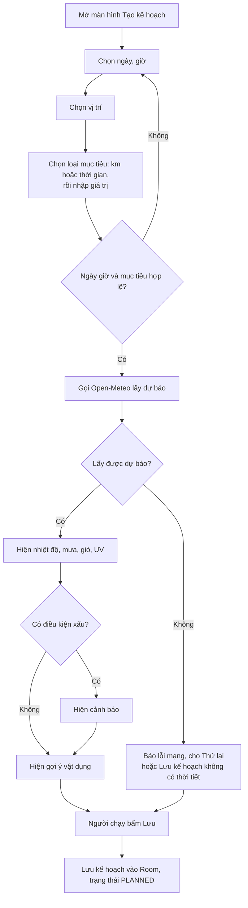
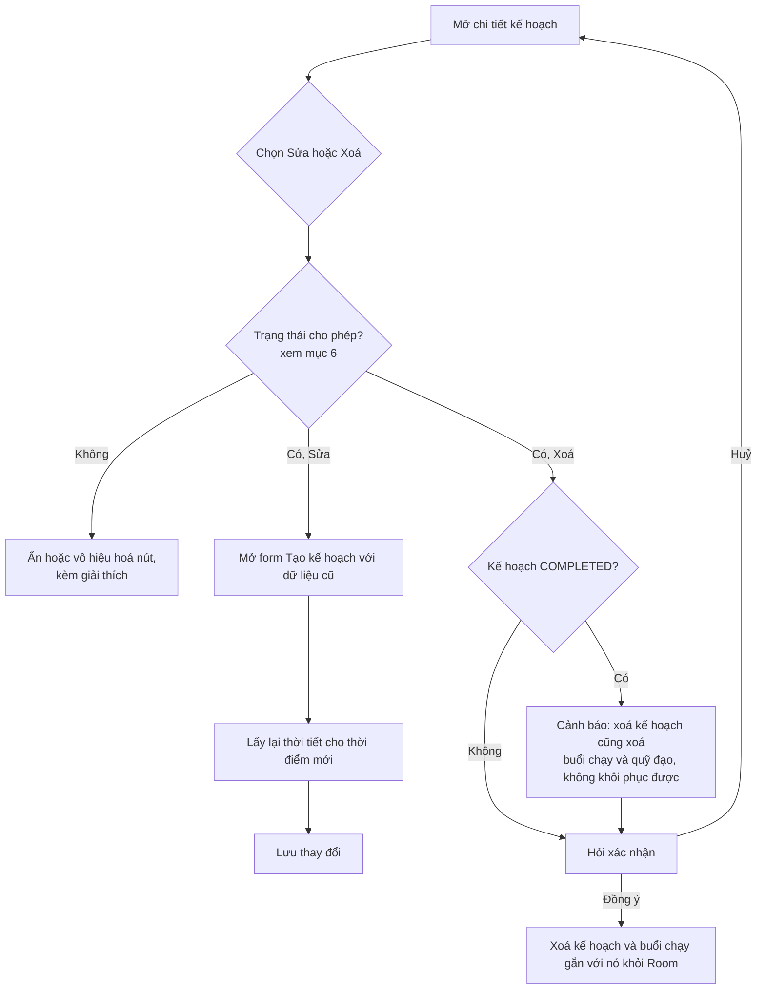
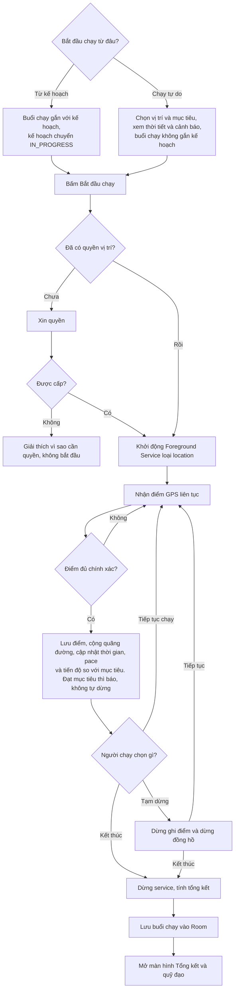
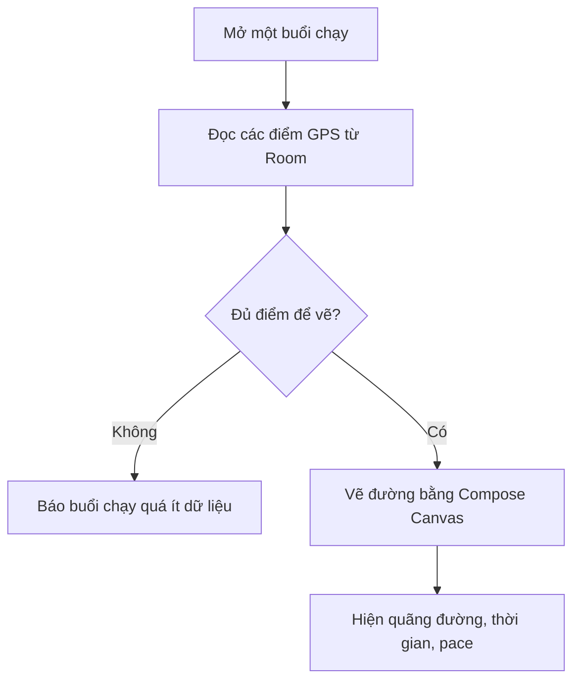
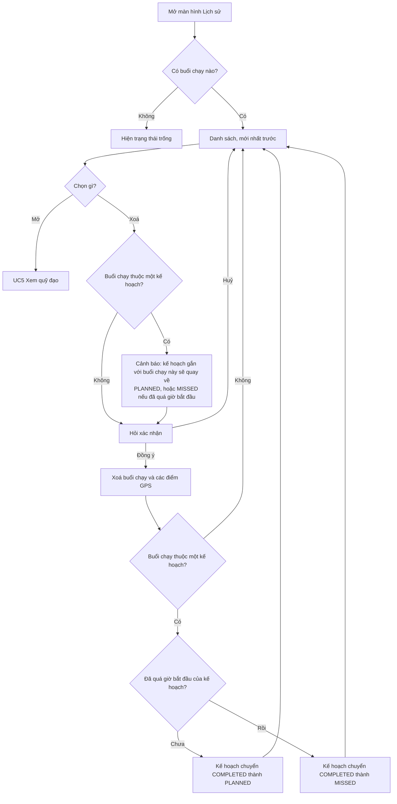
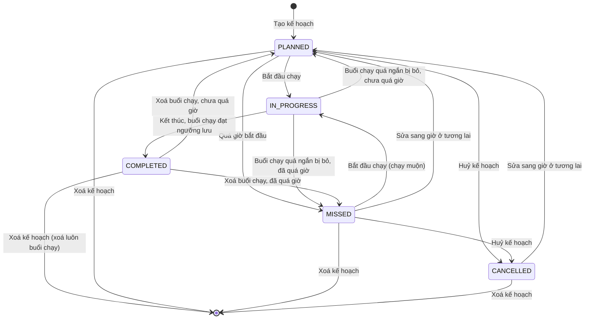

# RunMate: Đặc tả sản phẩm (SPEC)

> Trạng thái: **đang viết**. Đã xong mục 1–6. Các mục còn lại sẽ bổ sung sau.

## Mục lục

1. [Nền tảng](#1-nền-tảng)
2. [Đăng nhập tài khoản](#2-đăng-nhập-tài-khoản)
3. [Phạm vi MVP](#3-phạm-vi-mvp)
4. [Use case và sơ đồ flow](#4-use-case-và-sơ-đồ-flow)
5. [Quy tắc nghiệp vụ](#5-quy-tắc-nghiệp-vụ)
6. [Trạng thái kế hoạch](#6-trạng-thái-kế-hoạch)
7. Mô hình dữ liệu / ERD *(chưa viết)*
8. API và công nghệ *(chưa viết)*
9. Danh sách màn hình *(chưa viết)*
10. Yêu cầu phi chức năng *(chưa viết)*

---

## 1. Nền tảng

| Mục | Giá trị | Ghi chú |
|---|---|---|
| Nền tảng | Android | Chưa làm iOS hay web |
| Ngôn ngữ | Kotlin | |
| Build | Gradle (Kotlin DSL), JDK 17 | |
| `minSdk` | **26** (Android 8.0) | Máy Android 7.1 trở xuống không cài được |
| `targetSdk` | **35** (Android 15) |  |
| `compileSdk` | Bằng `targetSdk` | |
| Thiết bị kiểm thử | Máy thật cho phần GPS | Máy ảo chỉ giả lập vị trí, không phản ánh đúng thực tế |

**Vì sao `minSdk` 26:** từ Android 8.0 có sẵn các API thời gian (`java.time`) và kênh thông báo (notification channel). Cả hai đều cần cho kế hoạch theo giờ và thông báo của foreground service. Nhờ vậy không phải xử lý thêm cho các bản Android cũ.

**Liên quan tới GPS nền:** từ Android 14 (API 34), foreground service bắt buộc khai báo loại `location`.

## 2. Đăng nhập tài khoản

**Quyết định: MVP không có tài khoản. Toàn bộ dữ liệu chỉ lưu trên máy.**

| Mục | Nội dung |
|---|---|
| Nơi lưu | Cơ sở dữ liệu Room (SQLite) trên thiết bị |
| Backend | Không có |
| Đồng bộ nhiều thiết bị | Không có |
| Sao lưu | Không có. Gỡ app hoặc xoá dữ liệu app thì mất lịch sử |
| Quyền riêng tư | Dữ liệu vị trí không rời khỏi máy. Chỉ gửi toạ độ của địa điểm đã chọn tới Open-Meteo để lấy thời tiết |

**Lý do:**
- README không có backend, và MVP không có chia sẻ hay bảng xếp hạng nên không cần danh tính người dùng.
- Không phải xây, bảo mật và vận hành server.
- Không cần xin người dùng thông tin cá nhân.

**Đánh đổi:** người dùng mất dữ liệu khi đổi máy. Có thể xét xuất/nhập file hoặc đăng nhập kèm đồng bộ ở phiên bản sau MVP.

## 3. Phạm vi MVP

### Có trong MVP

| # | Tính năng | Mô tả ngắn |
|---|---|---|
| F1 | Lên kế hoạch chạy | Chọn ngày, giờ, vị trí và **mục tiêu** (chọn một: số km hoặc thời gian chạy) |
| F2 | Đánh giá thời tiết | Dự báo nhiệt độ, khả năng mưa, gió, UV tại thời điểm và vị trí đã chọn, áp dụng cho cả kế hoạch lẫn chạy tự do. Cảnh báo khi thời tiết xấu. Gợi ý vật dụng nên mang |
| F3 | Ghi một buổi chạy | GPS, quãng đường, thời gian, pace |
| F4 | Xem lại quỹ đạo | Vẽ đường đã chạy bằng Compose Canvas, chưa có bản đồ nền |
| F5 | Lưu lịch sử | Lưu mọi buổi chạy, xem lại và xoá |

### Ngoài MVP (làm sau)

| Phiên bản | Tính năng |
|---|---|
| v1.1 | Thông báo trước giờ chạy 30 phút, kèm dự báo lại thời tiết |
| v1.2 | Hiển thị quỹ đạo trên bản đồ nền |
| v1.2 | Vẽ đường theo thời gian thực trong lúc chạy |

### Không làm (cả MVP)

- Tài khoản, đăng nhập, đồng bộ đám mây
- Chia sẻ lên mạng xã hội, bạn bè, bảng xếp hạng
- Kết nối đồng hồ thông minh hay cảm biến nhịp tim
- Huấn luyện, giáo án chạy, thống kê nâng cao

## 4. Use case và sơ đồ flow

**Tác nhân duy nhất:** Người chạy (người dùng app). Ngoài ra có hai hệ thống bên ngoài: Open-Meteo (dữ liệu thời tiết) và dịch vụ vị trí của Android (GPS).

### 4.1 Danh sách use case

| Mã | Use case | Tính năng | Mô tả |
|---|---|---|---|
| UC1 | Tạo kế hoạch chạy | F1 | Người chạy chọn ngày, giờ, vị trí và mục tiêu (km hoặc thời gian) rồi lưu kế hoạch |
| UC2 | Xem thời tiết và cảnh báo | F2 | App lấy dự báo cho kế hoạch, hiện cảnh báo và gợi ý vật dụng |
| UC3 | Sửa hoặc xoá kế hoạch | F1 | Chỉ làm được khi kế hoạch ở trạng thái cho phép (xem mục 6). Xoá kế hoạch `COMPLETED` sẽ xoá luôn buổi chạy gắn với nó, có cảnh báo trước |
| UC4 | Ghi buổi chạy | F3 | Bắt đầu **từ một kế hoạch hoặc chạy tự do**. Chạy tự do vẫn phải chọn vị trí và mục tiêu, và vẫn xem được thời tiết. Sau đó tạm dừng, tiếp tục và kết thúc. GPS ghi cả khi tắt màn hình |
| UC5 | Xem quỹ đạo | F4 | Xem đường đã chạy và số liệu tổng kết của buổi chạy |
| UC6 | Xem và xoá lịch sử | F5 | Xem danh sách buổi chạy, mở chi tiết, xoá. Buổi chạy tự do xoá trực tiếp được. Xoá riêng buổi chạy của một kế hoạch thì kế hoạch quay về `PLANNED` hoặc `MISSED`, có cảnh báo |

### 4.2 Sơ đồ use case tổng quát

### 4.3 Flow từng use case

#### UC1 + UC2: Tạo kế hoạch và xem thời tiết

#### UC3: Sửa hoặc xoá kế hoạch

#### UC4: Ghi buổi chạy

#### UC5: Xem quỹ đạo

#### UC6: Xem và xoá lịch sử

### 4.4 Lưu ý

- Chạy tự do vẫn phải chọn vị trí và mục tiêu để app lấy được dự báo thời tiết, cảnh báo và gợi ý vật dụng giống như kế hoạch. Vì vậy dữ liệu thời tiết lưu được cho cả hai loại.
- Mục tiêu chỉ để theo dõi tiến độ và so sánh khi tổng kết. Đạt mục tiêu thì báo cho người chạy, app không tự dừng buổi chạy.

## 5. Quy tắc nghiệp vụ

> Các con số dưới đây là **đề xuất**, chưa kiểm chứng bằng thực tế. Mỗi số sẽ được đặt thành hằng số trong code để chỉnh dễ. Sau khi chạy thử bằng máy thật có thể phải đổi.

### 5.1 Kế hoạch và mục tiêu

| Mã | Quy tắc | Giá trị |
|---|---|---|
| BR-01 | Thời điểm bắt đầu của kế hoạch phải **không nằm trong quá khứ** | ≥ thời điểm hiện tại |
| BR-02 | Chỉ đặt kế hoạch trong vòng tối đa kể từ hiện tại | **16 ngày** (theo giới hạn dự báo theo giờ của Open-Meteo trong README) |
| BR-03 | Mỗi kế hoạch có đúng **một** mục tiêu, bắt buộc | Loại `DISTANCE` (km) hoặc `DURATION` (phút) |
| BR-04 | Mục tiêu quãng đường | **0,5 km đến 100 km**, bước nhập 0,1 km |
| BR-05 | Mục tiêu thời gian | **5 phút đến 12 giờ** (720 phút), bước nhập 1 phút |
| BR-06 | Vị trí kế hoạch là một toạ độ (vĩ độ, kinh độ) kèm tên hiển thị | Bắt buộc. Chọn vị trí hiện tại hoặc tự chọn |
| BR-07 | Không giới hạn số kế hoạch cùng lúc, và cho phép trùng giờ | Không giới hạn |
| BR-08 | Chỉ **một** buổi chạy được diễn ra tại một thời điểm | Tối đa 1 buổi chạy `IN_PROGRESS` |

### 5.2 Thời tiết, cảnh báo và gợi ý vật dụng

**Mốc thời gian dự báo:** lấy dự báo theo giờ của **giờ bắt đầu**, làm tròn xuống giờ chẵn. Với chạy tự do, giờ bắt đầu là bây giờ. App chưa ước tính giờ kết thúc (xem Q5).

**Ngưỡng cảnh báo:**

| Mã | Điều kiện | Ngưỡng (đề xuất) | Cảnh báo |
|---|---|---|---|
| BR-10 | Khả năng mưa | ≥ **50%** | Có thể mưa |
| BR-11 | Nhiệt độ | ≥ **35°C** | Quá nóng |
| BR-12 | Tốc độ gió | ≥ **30 km/h** | Gió mạnh |
| BR-13 | Chỉ số UV | ≥ **8** | UV cao |

**Quy tắc kèm theo:**
- Có thể xảy ra nhiều cảnh báo cùng lúc, hiện tất cả.
- Cảnh báo chỉ **thông báo**, không chặn người dùng lưu kế hoạch hay bắt đầu chạy.
- Chưa có cảnh báo lạnh trong MVP.

**Gợi ý vật dụng:**

| Mã | Điều kiện | Gợi ý |
|---|---|---|
| BR-20 | Mưa ≥ 50% | Áo mưa |
| BR-21 | UV ≥ 8 | Mũ, kem chống nắng |
| BR-22 | Nhiệt độ ≥ 35°C | Mũ, nước uống |
| BR-23 | Gió ≥ 30 km/h | Áo khoác chắn gió |
| BR-24 | Mục tiêu ≥ 10 km, hoặc ≥ 60 phút | Nước uống |

**Dữ liệu thời tiết:**
- Lưu cùng kế hoạch hoặc buổi chạy kèm **thời điểm lấy**, để dùng khi không có mạng.
- Mở chi tiết kế hoạch và có mạng thì lấy lại nếu dữ liệu đã lưu **hơn 3 giờ**.
- Không có mạng thì hiện dữ liệu đã lưu kèm nhãn "cập nhật lúc …". Chưa từng có dữ liệu thì hiện thông báo không có thời tiết.
- Lỗi thời tiết **không chặn** lưu kế hoạch hay bắt đầu chạy.

### 5.3 Ghi buổi chạy

| Mã | Quy tắc | Giá trị (đề xuất) |
|---|---|---|
| BR-30 | **Lọc điểm kém chính xác:** bỏ điểm GPS có sai số lớn hơn | **30 m** |
| BR-31 | **Lọc điểm nhảy bất thường:** bỏ điểm khiến tốc độ giữa hai điểm liên tiếp vượt | **12 m/s** (khoảng 43 km/h) |
| BR-32 | Tần suất yêu cầu vị trí | Khoảng **2 giây** một lần. Chưa chắc, cần thử trên máy thật để cân bằng chính xác và pin |
| BR-33 | Quãng đường | Tổng khoảng cách giữa các điểm hợp lệ liên tiếp, **không** tính đoạn nối qua lúc tạm dừng |
| BR-34 | Thời gian chạy | Chỉ tính lúc đang ghi, **không** tính lúc tạm dừng |
| BR-35 | Pace | **Phút/km** = thời gian chạy ÷ quãng đường. Chỉ hiện khi đã chạy ≥ **100 m**, trước đó hiện "--" |
| BR-36 | **Ngưỡng lưu:** buổi chạy ngắn hơn một trong hai mốc dưới đây thì không lưu | **100 m** hoặc **1 phút**. Báo người dùng rằng buổi chạy quá ngắn nên đã bỏ |
| BR-37 | Điều kiện **đạt mục tiêu** | `DISTANCE`: quãng đường ≥ mục tiêu. `DURATION`: thời gian chạy ≥ mục tiêu |
| BR-38 | Khi đạt mục tiêu | Báo cho người dùng một lần, **không tự dừng** |

**Kết thúc buổi chạy:** người dùng chủ động bấm Kết thúc. App không tự kết thúc buổi chạy.

**Kết quả tổng kết:** quãng đường, thời gian chạy, pace trung bình, tỷ lệ đạt mục tiêu (quãng đường hoặc thời gian thực tế chia cho mục tiêu, có thể trên 100%).

### 5.4 Chạy tự do

| Mã | Quy tắc |
|---|---|
| BR-40 | Bắt đầu ngay, không có ngày giờ. Giờ bắt đầu là lúc bấm |
| BR-41 | Vị trí: mặc định là vị trí hiện tại, người dùng đổi được. Bắt buộc có vị trí để lấy thời tiết |
| BR-42 | Mục tiêu bắt buộc, theo cùng quy tắc BR-03 đến BR-05 |
| BR-43 | Không tạo kế hoạch và không có trạng thái kế hoạch. Buổi chạy lưu thẳng vào lịch sử |

### 5.5 Lịch sử và xoá dữ liệu

| Mã | Quy tắc |
|---|---|
| BR-50 | Lịch sử sắp xếp **mới nhất trước** |
| BR-51 | Không tự xoá dữ liệu cũ. Chỉ xoá khi người dùng xoá |
| BR-52 | Xoá kế hoạch `COMPLETED` thì xoá luôn buổi chạy và các điểm GPS, có cảnh báo (Q1) |
| BR-53 | Xoá riêng buổi chạy của một kế hoạch thì kế hoạch về `PLANNED` hoặc `MISSED`, có cảnh báo (Q3, Q5) |
| BR-54 | Mọi thao tác xoá đều **hỏi xác nhận** và không khôi phục được |

## 6. Trạng thái kế hoạch

Chỉ **kế hoạch** có trạng thái. Chạy tự do không có kế hoạch nên không có trạng thái này (BR-43).

### 6.1 Danh sách trạng thái

| Trạng thái | Ý nghĩa | Hiển thị |
|---|---|---|
| `PLANNED` | Đã lên kế hoạch, chưa đến giờ hoặc chưa chạy, giờ bắt đầu còn ở tương lai | Đã lên kế hoạch |
| `IN_PROGRESS` | Đang có một buổi chạy gắn với kế hoạch | Đang chạy |
| `COMPLETED` | Đã chạy xong và có buổi chạy được lưu | Hoàn thành |
| `MISSED` | Quá giờ bắt đầu mà chưa chạy | Bỏ lỡ |
| `CANCELLED` | Người dùng chủ động huỷ kế hoạch | Đã huỷ |

### 6.2 Sơ đồ chuyển trạng thái

### 6.3 Bảng chuyển trạng thái

| Từ | Sang | Điều kiện hoặc hành động |
|---|---|---|
| (mới) | `PLANNED` | Lưu kế hoạch hợp lệ (BR-01 đến BR-06) |
| `PLANNED` | `IN_PROGRESS` | Bấm Bắt đầu chạy, và chưa có buổi chạy nào khác đang diễn ra (BR-08) |
| `PLANNED` | `MISSED` | Giờ hiện tại > giờ bắt đầu (Q5) |
| `PLANNED` | `CANCELLED` | Người dùng bấm Huỷ kế hoạch |
| `MISSED` | `IN_PROGRESS` | Bấm Bắt đầu chạy muộn |
| `MISSED` | `PLANNED` | Sửa sang giờ bắt đầu ở tương lai |
| `MISSED` | `CANCELLED` | Người dùng bấm Huỷ kế hoạch |
| `CANCELLED` | `PLANNED` | Sửa sang giờ bắt đầu ở tương lai (coi như lên lại kế hoạch) |
| `IN_PROGRESS` | `COMPLETED` | Bấm Kết thúc, buổi chạy ≥ 100 m và ≥ 1 phút (BR-36) |
| `IN_PROGRESS` | `PLANNED` hoặc `MISSED` | Buổi chạy quá ngắn nên không lưu. Chưa quá giờ thì về `PLANNED`, quá rồi thì về `MISSED` |
| `COMPLETED` | `PLANNED` hoặc `MISSED` | Xoá riêng buổi chạy (Q3). Chưa quá giờ thì về `PLANNED`, quá rồi thì về `MISSED` |

**Cách phát hiện `MISSED`:** app so giờ hiện tại với giờ bắt đầu mỗi khi mở app và mỗi khi hiển thị danh sách hoặc chi tiết kế hoạch, rồi cập nhật trạng thái. MVP chưa cần tác vụ chạy nền. Thông báo trước giờ chạy ở v1.1 mới cần hẹn giờ.

### 6.4 Quy tắc sửa và xoá theo trạng thái

| Trạng thái | Sửa kế hoạch | Xoá kế hoạch | Ghi chú |
|---|---|---|---|
| `PLANNED` | Được | Được | Hỏi xác nhận khi xoá |
| `IN_PROGRESS` | **Không** | **Không** | Phải kết thúc buổi chạy trước. Nút bị vô hiệu hoá, kèm giải thích |
| `COMPLETED` | **Không** | Được, **xoá luôn buổi chạy** | Cảnh báo "không khôi phục được" (Q1) |
| `MISSED` | Được | Được | Sửa sang giờ ở tương lai thì về `PLANNED` |
| `CANCELLED` | Được | Được | Sửa sang giờ ở tương lai thì về `PLANNED` |

**Quy tắc bổ sung:**
- Sửa kế hoạch gồm đổi ngày, giờ, vị trí và mục tiêu. Sau khi sửa thì lấy lại thời tiết.
- Khi `MISSED` hoặc `CANCELLED` được sửa mà giờ mới vẫn ở quá khứ thì **không cho lưu** (BR-01).
- Kế hoạch `COMPLETED` không cho sửa vì sẽ làm kế hoạch lệch với buổi chạy thật.
- Nếu app bị hệ thống tắt giữa lúc chạy, kế hoạch vẫn là `IN_PROGRESS`. Lần mở app sau hỏi người dùng tiếp tục hay kết thúc buổi chạy. Phần này sẽ nói kỹ hơn ở mục 10.

