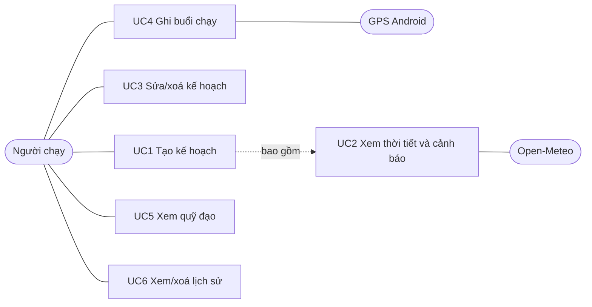
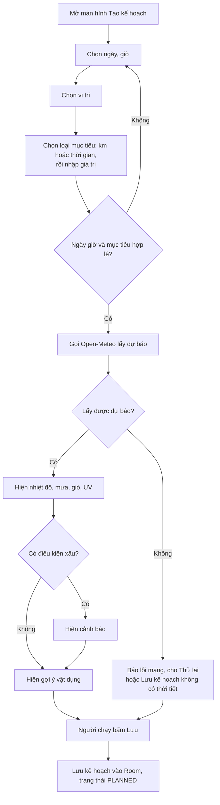
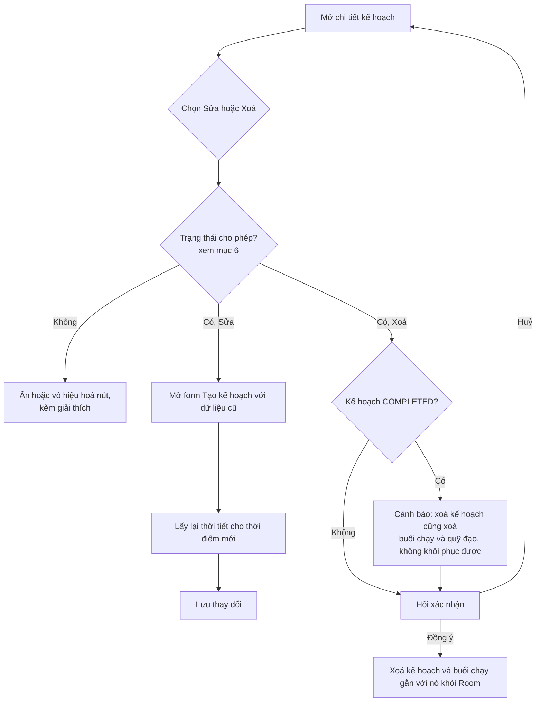
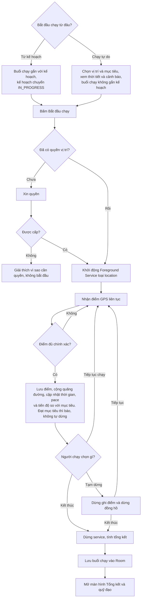
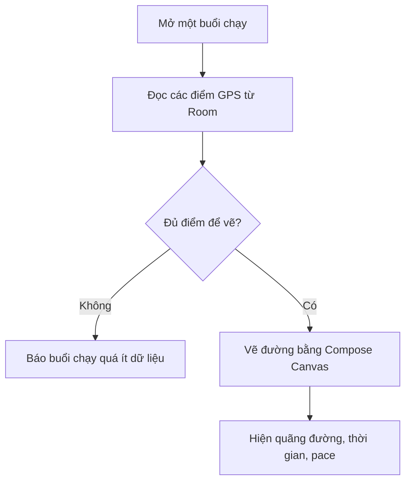
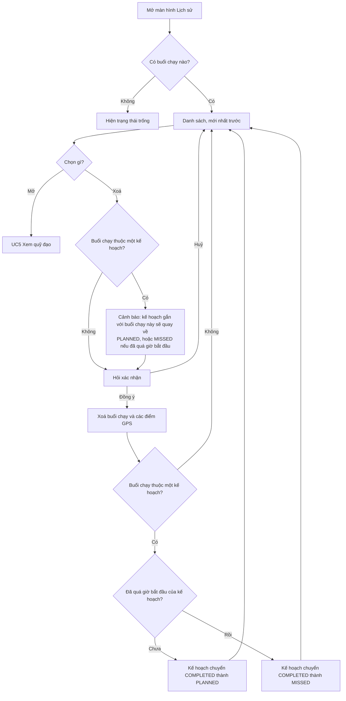
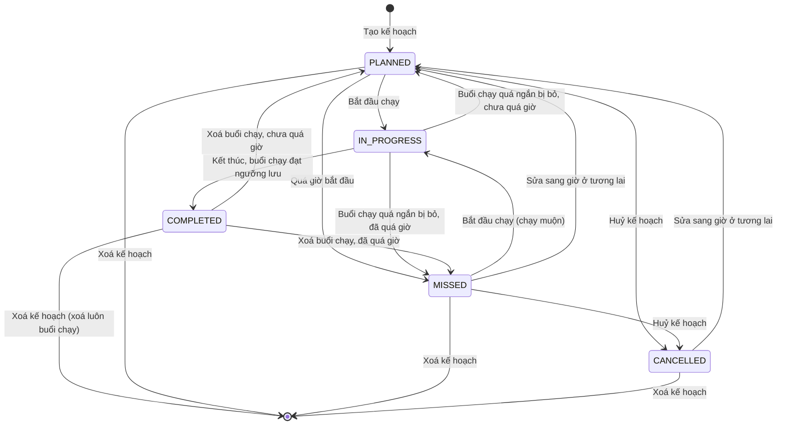
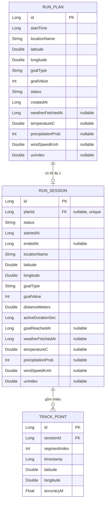
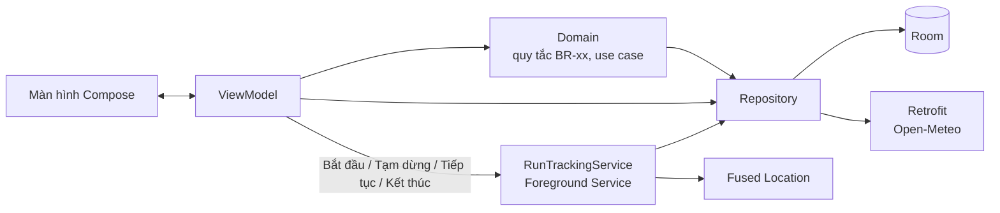
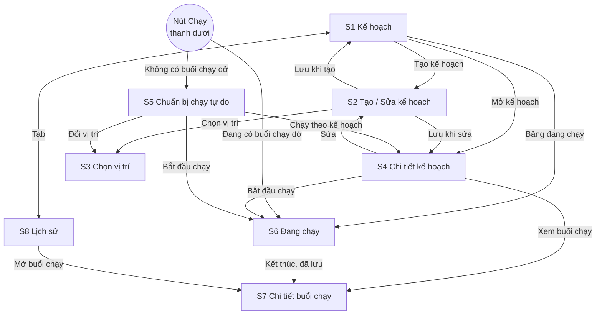

# RunMate: Đặc tả sản phẩm (SPEC)

> Trạng thái: **chờ duyệt**. Đã viết xong mục 1–10.

## Mục lục

1. [Nền tảng](#1-nền-tảng)
2. [Đăng nhập tài khoản](#2-đăng-nhập-tài-khoản)
3. [Phạm vi MVP](#3-phạm-vi-mvp)
4. [Use case và sơ đồ flow](#4-use-case-và-sơ-đồ-flow)
5. [Quy tắc nghiệp vụ](#5-quy-tắc-nghiệp-vụ)
6. [Trạng thái kế hoạch](#6-trạng-thái-kế-hoạch)
7. [Mô hình dữ liệu / ERD](#7-mô-hình-dữ-liệu--erd)
8. [API và công nghệ](#8-api-và-công-nghệ)
9. [Danh sách màn hình](#9-danh-sách-màn-hình)
10. [Yêu cầu phi chức năng](#10-yêu-cầu-phi-chức-năng)

---

## 1. Nền tảng

| Mục | Giá trị | Ghi chú |
|---|---|---|
| Nền tảng | Android | Chưa làm iOS hay web |
| Ngôn ngữ | Kotlin | |
| Build | Gradle (Kotlin DSL), JDK 17 | |
| `minSdk` | **26** (Android 8.0) | Máy Android 7.1 trở xuống không cài được |
| `targetSdk` | **36** (Android 16) | Google Play yêu cầu app mới nhắm API 36 trở lên từ 31/08/2026 ([nguồn](https://developer.android.com/google/play/requirements/target-sdk)) |
| `compileSdk` | **37** | Thư viện mới có thể yêu cầu cao hơn `targetSdk`. Đã kiểm chứng 26/10/2026 (A1): 37 build được, chưa thử 36 |
| Thiết bị kiểm thử | Máy thật cho phần GPS | Máy ảo chỉ giả lập vị trí, không phản ánh đúng thực tế |

**Vì sao `minSdk` 26:** từ Android 8.0 có sẵn các API thời gian (`java.time`) và kênh thông báo (notification channel). Cả hai đều cần cho kế hoạch theo giờ và thông báo của foreground service. Nhờ vậy không phải xử lý thêm cho các bản Android cũ.

**Liên quan tới GPS nền:** từ Android 14 (API 34), foreground service bắt buộc khai báo loại `location`.

## 2. Đăng nhập tài khoản

**Quyết định: MVP không có tài khoản. Toàn bộ dữ liệu chỉ lưu trên máy.**

| Mục | Nội dung |
|---|---|
| Nơi lưu | Cơ sở dữ liệu Room (SQLite) trên thiết bị |
| Backend | Không có |
| Đồng bộ nhiều thiết bị | Không có |
| Sao lưu | Không có. Gỡ app hoặc xoá dữ liệu app thì mất lịch sử |
| Quyền riêng tư | Điểm GPS lúc chạy không rời khỏi máy. Chỉ gửi toạ độ địa điểm đã chọn tới Open-Meteo để lấy thời tiết, và chữ người dùng gõ khi tìm địa điểm (mục 8.2, 10.4) |

**Lý do:**
- README không có backend, và MVP không có chia sẻ hay bảng xếp hạng nên không cần danh tính người dùng.
- Không phải xây, bảo mật và vận hành server.
- Không cần xin người dùng thông tin cá nhân.

**Đánh đổi:** người dùng mất dữ liệu khi đổi máy. Có thể xét xuất/nhập file hoặc đăng nhập kèm đồng bộ ở phiên bản sau MVP.

## 3. Phạm vi MVP

### Có trong MVP

| # | Tính năng | Mô tả ngắn |
|---|---|---|
| F1 | Lên kế hoạch chạy | Chọn ngày, giờ, vị trí và **mục tiêu** (chọn một: số km hoặc thời gian chạy) |
| F2 | Đánh giá thời tiết | Dự báo nhiệt độ, khả năng mưa, gió, UV tại thời điểm và vị trí đã chọn, áp dụng cho cả kế hoạch lẫn chạy tự do. Cảnh báo khi thời tiết xấu. Gợi ý vật dụng nên mang |
| F3 | Ghi một buổi chạy | GPS, quãng đường, thời gian, pace |
| F4 | Xem lại quỹ đạo | Vẽ đường đã chạy bằng Compose Canvas, chưa có bản đồ nền |
| F5 | Lưu lịch sử | Lưu mọi buổi chạy, xem lại và xoá |

### Ngoài MVP (làm sau)

| Phiên bản | Tính năng |
|---|---|
| v1.1 | Thông báo trước giờ chạy 30 phút, kèm dự báo lại thời tiết |
| v1.2 | Hiển thị quỹ đạo trên bản đồ nền |
| v1.2 | Vẽ đường theo thời gian thực trong lúc chạy |

### Không làm (cả MVP)

- Tài khoản, đăng nhập, đồng bộ đám mây
- Chia sẻ lên mạng xã hội, bạn bè, bảng xếp hạng
- Kết nối đồng hồ thông minh hay cảm biến nhịp tim
- Huấn luyện, giáo án chạy, thống kê nâng cao

## 4. Use case và sơ đồ flow

**Tác nhân duy nhất:** Người chạy (người dùng app). Ngoài ra có hai hệ thống bên ngoài: Open-Meteo (dữ liệu thời tiết) và dịch vụ vị trí của Android (GPS).

### 4.1 Danh sách use case

| Mã | Use case | Tính năng | Mô tả |
|---|---|---|---|
| UC1 | Tạo kế hoạch chạy | F1 | Người chạy chọn ngày, giờ, vị trí và mục tiêu (km hoặc thời gian) rồi lưu kế hoạch |
| UC2 | Xem thời tiết và cảnh báo | F2 | App lấy dự báo cho kế hoạch, hiện cảnh báo và gợi ý vật dụng |
| UC3 | Sửa hoặc xoá kế hoạch | F1 | Chỉ làm được khi kế hoạch ở trạng thái cho phép (xem mục 6). Xoá kế hoạch `COMPLETED` sẽ xoá luôn buổi chạy gắn với nó, có cảnh báo trước |
| UC4 | Ghi buổi chạy | F3 | Bắt đầu **từ một kế hoạch hoặc chạy tự do**. Chạy tự do vẫn phải chọn vị trí và mục tiêu, và vẫn xem được thời tiết. Sau đó tạm dừng, tiếp tục và kết thúc. GPS ghi cả khi tắt màn hình |
| UC5 | Xem quỹ đạo | F4 | Xem đường đã chạy và số liệu tổng kết của buổi chạy |
| UC6 | Xem và xoá lịch sử | F5 | Xem danh sách buổi chạy, mở chi tiết, xoá. Buổi chạy tự do xoá trực tiếp được. Xoá riêng buổi chạy của một kế hoạch thì kế hoạch quay về `PLANNED` hoặc `MISSED`, có cảnh báo |

### 4.2 Sơ đồ use case tổng quát

### 4.3 Flow từng use case

#### UC1 + UC2: Tạo kế hoạch và xem thời tiết

#### UC3: Sửa hoặc xoá kế hoạch

#### UC4: Ghi buổi chạy

#### UC5: Xem quỹ đạo

#### UC6: Xem và xoá lịch sử

### 4.4 Lưu ý

- Chạy tự do vẫn phải chọn vị trí và mục tiêu để app lấy được dự báo thời tiết, cảnh báo và gợi ý vật dụng giống như kế hoạch. Vì vậy dữ liệu thời tiết lưu được cho cả hai loại.
- Mục tiêu chỉ để theo dõi tiến độ và so sánh khi tổng kết. Đạt mục tiêu thì báo cho người chạy, app không tự dừng buổi chạy.

### 4.5 User stories

Tất cả user story đều là của **người chạy** (tác nhân duy nhất, mục 4). Từ US2 trở đi lược phần "Là người chạy" cho gọn. Tiêu chí chấp nhận trỏ tới BR thay vì chép lại con số, để khi đổi số chỉ cần sửa ở mục 5.

| Mã | User story | Tiêu chí chấp nhận | Liên quan |
|---|---|---|---|
| US1 | Là người chạy, tôi muốn **đặt kế hoạch** với ngày giờ, vị trí và mục tiêu, để chủ động sắp xếp lịch tập | Không chọn được giờ trong quá khứ hoặc quá 16 ngày (BR-01, BR-02). Mục tiêu nằm trong giới hạn (BR-04, BR-05). Lưu xong thì thấy kế hoạch ở S1 với nhãn "Đã lên kế hoạch" | UC1 |
| US2 | Tôi muốn **chọn vị trí** bằng vị trí hiện tại hoặc gõ tên, để không phải nhập toạ độ | Có cả 2 cách (mục 8.2). Mất mạng thì tìm theo tên báo lỗi nhưng vẫn dùng được vị trí hiện tại (10.3) | UC1 |
| US3 | Tôi muốn **xem dự báo thời tiết** đúng giờ và nơi sẽ chạy, để quyết định có chạy hay không | Hiện nhiệt độ, mưa, gió, UV của giờ bắt đầu (5.2). Không có mạng thì hiện "cập nhật lúc …". Lỗi thời tiết không chặn việc lưu | UC2 |
| US4 | Tôi muốn **được cảnh báo và gợi ý vật dụng**, để chuẩn bị đồ phù hợp | Cảnh báo theo BR-10 đến BR-13, nhiều cảnh báo thì hiện tất cả. Gợi ý theo BR-20 đến BR-24 | UC2 |
| US5 | Tôi muốn **sửa, huỷ hoặc xoá kế hoạch** khi lịch thay đổi | Nút bật hoặc tắt đúng bảng 6.4, nút bị tắt có giải thích. Xoá kế hoạch `COMPLETED` thì có cảnh báo mất buổi chạy | UC3 |
| US6 | Tôi muốn **thấy kế hoạch nào đã bỏ lỡ**, để biết mình giữ lịch tốt đến đâu | Quá ân hạn (BR-09) mà chưa chạy thì hiện "Bỏ lỡ". Vẫn chạy muộn được từ S4 | Mục 6 |
| US7 | Tôi muốn **bấm Chạy là chạy ngay**, không cần lên kế hoạch trước | Vị trí mặc định là vị trí hiện tại, mục tiêu bắt buộc (BR-41, BR-42). Có kế hoạch trong khoảng gợi ý thì hiện gợi ý (BR-44) | UC4 |
| US8 | Trong lúc chạy, tôi muốn **thấy quãng đường, thời gian, pace và tiến độ**, để giữ nhịp | Pace hiện "--" khi chưa đủ 100 m (BR-35). Đạt mục tiêu thì báo một lần, không tự dừng (BR-38). Tắt màn hình vẫn ghi | UC4 |
| US9 | Tôi muốn **tạm dừng** khi dừng đèn đỏ hay nghỉ, để số liệu không bị tính sai | Lúc tạm dừng không tính thời gian (BR-34) và không cộng quãng đường (BR-33). Quỹ đạo đứt tại chỗ dừng (`segmentIndex`) | UC4 |
| US10 | Tôi muốn **không mất buổi chạy** nếu app bị tắt giữa chừng | Mở lại app thì có hộp thoại Tiếp tục hoặc Kết thúc (10.1). Quá 1 giờ thì chỉ còn Kết thúc (BR-60) | Mục 10.1 |
| US11 | Sau khi chạy, tôi muốn **xem quỹ đạo và tổng kết**, để biết mình chạy so với mục tiêu ra sao | Có quãng đường, thời gian, pace trung bình, tỷ lệ đạt mục tiêu (có thể trên 100%). Quá ít điểm thì báo thiếu dữ liệu | UC5 |
| US12 | Tôi muốn **xem và xoá lịch sử** các buổi chạy | Mới nhất trước (BR-50). Xoá thì hỏi xác nhận (BR-54). Xoá buổi thuộc kế hoạch thì kế hoạch về `PLANNED` hoặc `MISSED` (BR-53) | UC6 |

## 5. Quy tắc nghiệp vụ

> Các con số dưới đây là **đề xuất**, chưa kiểm chứng bằng thực tế. Mỗi số sẽ được đặt thành hằng số trong code để chỉnh dễ. Sau khi chạy thử bằng máy thật có thể phải đổi.

### 5.1 Kế hoạch và mục tiêu

| Mã | Quy tắc | Giá trị |
|---|---|---|
| BR-01 | Thời điểm bắt đầu của kế hoạch phải **không nằm trong quá khứ** | ≥ thời điểm hiện tại |
| BR-02 | Chỉ đặt kế hoạch trong vòng tối đa kể từ hiện tại | **16 ngày** (theo giới hạn dự báo theo giờ của Open-Meteo trong README) |
| BR-03 | Mỗi kế hoạch có đúng **một** mục tiêu, bắt buộc | Loại `DISTANCE` (km) hoặc `DURATION` (phút) |
| BR-04 | Mục tiêu quãng đường | **0,5 km đến 100 km**, bước nhập 0,1 km |
| BR-05 | Mục tiêu thời gian | **5 phút đến 12 giờ** (720 phút), bước nhập 1 phút |
| BR-06 | Vị trí kế hoạch là một toạ độ (vĩ độ, kinh độ) kèm tên hiển thị | Bắt buộc. Chọn vị trí hiện tại hoặc tự chọn |
| BR-07 | Không giới hạn số kế hoạch cùng lúc, và cho phép trùng giờ | Không giới hạn |
| BR-08 | Chỉ **một** buổi chạy được diễn ra tại một thời điểm | Tối đa 1 buổi chạy `IN_PROGRESS` |
| BR-09 | **Ân hạn:** kế hoạch chỉ bị coi là **quá giờ** khi giờ hiện tại > giờ bắt đầu + ân hạn. Mọi chỗ trong SPEC nói "quá giờ" đều theo quy tắc này | **30 phút** |

### 5.2 Thời tiết, cảnh báo và gợi ý vật dụng

**Mốc thời gian dự báo:** lấy dự báo theo giờ của **giờ bắt đầu**, làm tròn xuống giờ chẵn. Với chạy tự do, giờ bắt đầu là bây giờ. App chưa ước tính giờ kết thúc.

**Ngưỡng cảnh báo:**

| Mã | Điều kiện | Ngưỡng (đề xuất) | Cảnh báo |
|---|---|---|---|
| BR-10 | Khả năng mưa | ≥ **50%** | Có thể mưa |
| BR-11 | Nhiệt độ | ≥ **35°C** | Quá nóng |
| BR-12 | Tốc độ gió | ≥ **30 km/h** | Gió mạnh |
| BR-13 | Chỉ số UV | ≥ **8** | UV cao |

**Quy tắc kèm theo:**
- Có thể xảy ra nhiều cảnh báo cùng lúc, hiện tất cả.
- Cảnh báo chỉ **thông báo**, không chặn người dùng lưu kế hoạch hay bắt đầu chạy.
- Chưa có cảnh báo lạnh trong MVP.

**Gợi ý vật dụng:**

| Mã | Điều kiện | Gợi ý |
|---|---|---|
| BR-20 | Mưa ≥ 50% | Áo mưa |
| BR-21 | UV ≥ 8 | Mũ, kem chống nắng |
| BR-22 | Nhiệt độ ≥ 35°C | Mũ, nước uống |
| BR-23 | Gió ≥ 30 km/h | Áo khoác chắn gió |
| BR-24 | Mục tiêu ≥ 10 km, hoặc ≥ 60 phút | Nước uống |

**Dữ liệu thời tiết:**
- Lưu cùng kế hoạch hoặc buổi chạy kèm **thời điểm lấy**, để dùng khi không có mạng.
- Mở chi tiết kế hoạch và có mạng thì lấy lại nếu dữ liệu đã lưu **hơn 3 giờ**.
- Kế hoạch `COMPLETED` hoặc `CANCELLED` thì **không lấy lại** thời tiết, chỉ hiện dữ liệu đã lưu.
- Không có mạng thì hiện dữ liệu đã lưu kèm nhãn "cập nhật lúc …". Chưa từng có dữ liệu thì hiện thông báo không có thời tiết.
- Lỗi thời tiết **không chặn** lưu kế hoạch hay bắt đầu chạy.

### 5.3 Ghi buổi chạy

| Mã | Quy tắc | Giá trị (đề xuất) |
|---|---|---|
| BR-30 | **Lọc điểm kém chính xác:** bỏ điểm GPS có sai số lớn hơn | **30 m** |
| BR-31 | **Lọc điểm nhảy bất thường:** bỏ điểm khiến tốc độ giữa hai điểm liên tiếp vượt | **12 m/s** (khoảng 43 km/h) |
| BR-32 | Tần suất yêu cầu vị trí | Khoảng **2 giây** một lần. Chạy thử 24/10 (Samsung S23+, máy đứng yên): thực tế khoảng 6–7 giây một điểm, bật hay khoá màn hình đều như nhau. Cần đo lại khi di chuyển (mục 10.7) |
| BR-33 | Quãng đường | Tổng khoảng cách giữa các điểm hợp lệ liên tiếp, **không** tính đoạn nối qua lúc tạm dừng |
| BR-34 | Thời gian chạy | Chỉ tính lúc đang ghi, **không** tính lúc tạm dừng |
| BR-35 | Pace | **Phút/km** = thời gian chạy ÷ quãng đường. Chỉ hiện khi đã chạy ≥ **100 m**, trước đó hiện "--" |
| BR-36 | **Ngưỡng lưu:** buổi chạy ngắn hơn một trong hai mốc dưới đây thì không lưu | **100 m** hoặc **1 phút**. Báo người dùng rằng buổi chạy quá ngắn nên đã bỏ |
| BR-37 | Điều kiện **đạt mục tiêu** | `DISTANCE`: quãng đường ≥ mục tiêu. `DURATION`: thời gian chạy ≥ mục tiêu |
| BR-38 | Khi đạt mục tiêu | Báo cho người dùng một lần, **không tự dừng** |

**Kết thúc buổi chạy:** người dùng chủ động bấm Kết thúc. App không tự kết thúc buổi chạy.

**Kết quả tổng kết:** quãng đường, thời gian chạy, pace trung bình, tỷ lệ đạt mục tiêu (quãng đường hoặc thời gian thực tế chia cho mục tiêu, có thể trên 100%).

### 5.4 Chạy tự do

| Mã | Quy tắc |
|---|---|
| BR-40 | Bắt đầu ngay, không có ngày giờ. Giờ bắt đầu là lúc bấm |
| BR-41 | Vị trí: mặc định là vị trí hiện tại, người dùng đổi được. Bắt buộc có vị trí để lấy thời tiết |
| BR-42 | Mục tiêu bắt buộc, theo cùng quy tắc BR-03 đến BR-05 |
| BR-43 | Không tạo kế hoạch và không có trạng thái kế hoạch. Buổi chạy lưu thẳng vào lịch sử |
| BR-44 | **Gợi ý chạy theo kế hoạch:** khi mở S5, nếu có kế hoạch `PLANNED` mà giờ hiện tại nằm trong **khoảng gợi ý** (từ giờ bắt đầu − **30 phút** (đề xuất) đến giờ bắt đầu + ân hạn BR-09), app hiện gợi ý "Bạn có kế hoạch lúc 06:00 · 5 km. Chạy theo kế hoạch này?". **Chạy theo kế hoạch** thì chuyển sang S4 của kế hoạch đó. **Bỏ qua** thì ở lại S5 và chạy tự do. Có nhiều kế hoạch khớp thì chỉ gợi ý kế hoạch có giờ bắt đầu gần bây giờ nhất. Quá ân hạn thì kế hoạch là `MISSED`, app không gợi ý, và buổi chạy là chạy tự do |

### 5.5 Lịch sử và xoá dữ liệu

| Mã | Quy tắc |
|---|---|
| BR-50 | Lịch sử sắp xếp **mới nhất trước** |
| BR-51 | Không tự xoá dữ liệu cũ. Chỉ xoá khi người dùng xoá |
| BR-52 | Xoá kế hoạch `COMPLETED` thì xoá luôn buổi chạy và các điểm GPS, có cảnh báo |
| BR-53 | Xoá riêng buổi chạy của một kế hoạch thì kế hoạch về `PLANNED` hoặc `MISSED`, có cảnh báo |
| BR-54 | Mọi thao tác xoá đều **hỏi xác nhận** và không khôi phục được |

## 6. Trạng thái kế hoạch

Chỉ **kế hoạch** có trạng thái. Chạy tự do không có kế hoạch nên không có trạng thái này (BR-43).

### 6.1 Danh sách trạng thái

| Trạng thái | Ý nghĩa | Hiển thị |
|---|---|---|
| `PLANNED` | Đã lên kế hoạch, chưa chạy và chưa quá giờ (BR-09) | Đã lên kế hoạch |
| `IN_PROGRESS` | Đang có một buổi chạy gắn với kế hoạch | Đang chạy |
| `COMPLETED` | Đã chạy xong và có buổi chạy được lưu | Hoàn thành |
| `MISSED` | Quá giờ (BR-09) mà chưa chạy | Bỏ lỡ |
| `CANCELLED` | Người dùng chủ động huỷ kế hoạch | Đã huỷ |

### 6.2 Sơ đồ chuyển trạng thái

### 6.3 Bảng chuyển trạng thái

| Từ | Sang | Điều kiện hoặc hành động |
|---|---|---|
| (mới) | `PLANNED` | Lưu kế hoạch hợp lệ (BR-01 đến BR-06) |
| `PLANNED` | `IN_PROGRESS` | Bấm Bắt đầu chạy, và chưa có buổi chạy nào khác đang diễn ra (BR-08) |
| `PLANNED` | `MISSED` | Quá giờ (BR-09) |
| `PLANNED` | `CANCELLED` | Người dùng bấm Huỷ kế hoạch |
| `MISSED` | `IN_PROGRESS` | Bấm Bắt đầu chạy muộn |
| `MISSED` | `PLANNED` | Sửa sang giờ bắt đầu ở tương lai |
| `MISSED` | `CANCELLED` | Người dùng bấm Huỷ kế hoạch |
| `CANCELLED` | `PLANNED` | Sửa sang giờ bắt đầu ở tương lai (coi như lên lại kế hoạch) |
| `IN_PROGRESS` | `COMPLETED` | Bấm Kết thúc, buổi chạy ≥ 100 m và ≥ 1 phút (BR-36) |
| `IN_PROGRESS` | `PLANNED` hoặc `MISSED` | Buổi chạy quá ngắn nên không lưu. Chưa quá giờ thì về `PLANNED`, quá rồi thì về `MISSED` |
| `COMPLETED` | `PLANNED` hoặc `MISSED` | Xoá riêng buổi chạy. Chưa quá giờ thì về `PLANNED`, quá rồi thì về `MISSED` |

**Cách phát hiện `MISSED`:** app so giờ hiện tại với giờ bắt đầu mỗi khi mở app và mỗi khi hiển thị danh sách hoặc chi tiết kế hoạch, rồi cập nhật trạng thái. MVP chưa cần tác vụ chạy nền. Thông báo trước giờ chạy ở v1.1 mới cần hẹn giờ.

### 6.4 Quy tắc sửa và xoá theo trạng thái

| Trạng thái | Sửa kế hoạch | Xoá kế hoạch | Ghi chú |
|---|---|---|---|
| `PLANNED` | Được | Được | Hỏi xác nhận khi xoá |
| `IN_PROGRESS` | **Không** | **Không** | Phải kết thúc buổi chạy trước. Nút bị vô hiệu hoá, kèm giải thích |
| `COMPLETED` | **Không** | Được, **xoá luôn buổi chạy** | Cảnh báo "không khôi phục được" |
| `MISSED` | Được | Được | Sửa sang giờ ở tương lai thì về `PLANNED` |
| `CANCELLED` | Được | Được | Sửa sang giờ ở tương lai thì về `PLANNED` |

**Quy tắc bổ sung:**
- Sửa kế hoạch gồm đổi ngày, giờ, vị trí và mục tiêu. Sau khi sửa thì lấy lại thời tiết.
- Khi `MISSED` hoặc `CANCELLED` được sửa mà giờ mới vẫn ở quá khứ thì **không cho lưu** (BR-01).
- Kế hoạch `COMPLETED` không cho sửa vì sẽ làm kế hoạch lệch với buổi chạy thật.
- Nếu app bị hệ thống tắt giữa lúc chạy, kế hoạch vẫn là `IN_PROGRESS`. Lần mở app sau hỏi người dùng tiếp tục hay kết thúc buổi chạy. Xem mục 10.1.

## 7. Mô hình dữ liệu / ERD

Toàn bộ dữ liệu lưu bằng Room trên máy (mục 2). Có 3 bảng. Thời tiết là một nhóm cột gộp chung vào bảng (`@Embedded`), không phải bảng riêng.

### 7.1 Sơ đồ ERD

### 7.2 Bảng `run_plan`: kế hoạch chạy

| Cột | Kiểu | Bắt buộc | Ý nghĩa |
|---|---|---|---|
| `id` | Long, tự tăng | Có | Khoá chính |
| `startTime` | Long (epoch millis) | Có | Giờ bắt đầu (BR-01, BR-02) |
| `locationName` | String | Có | Tên hiển thị của vị trí (BR-06) |
| `latitude`, `longitude` | Double | Có | Toạ độ (BR-06) |
| `goalType` | String (`DISTANCE` / `DURATION`) | Có | Loại mục tiêu (BR-03) |
| `goalValue` | Int | Có | `DISTANCE`: **mét** (500–100 000). `DURATION`: **giây** (300–43 200) |
| `status` | String (`PlanStatus`) | Có | Trạng thái (mục 6) |
| `createdAt` | Long | Có | Lúc tạo |
| Nhóm thời tiết | `WeatherSnapshot`, nullable | Không | Rỗng khi chưa lấy được thời tiết (mục 5.2) |

### 7.3 Bảng `run_session`: buổi chạy

| Cột | Kiểu | Bắt buộc | Ý nghĩa |
|---|---|---|---|
| `id` | Long, tự tăng | Có | Khoá chính |
| `planId` | Long, nullable | Không | Rỗng nghĩa là chạy tự do. **Unique**: mỗi kế hoạch có tối đa 1 buổi chạy |
| `status` | String (`SessionStatus`) | Có | `RECORDING`, `PAUSED` hoặc `FINISHED` |
| `startedAt` | Long | Có | Lúc bấm Bắt đầu |
| `endedAt` | Long, nullable | Không | Lúc bấm Kết thúc |
| `locationName`, `latitude`, `longitude` | | Có | Chép từ kế hoạch, hoặc chọn khi chạy tự do (BR-41) |
| `goalType`, `goalValue` | | Có | Chép từ kế hoạch, hoặc nhập khi chạy tự do (BR-42) |
| `distanceMeters` | Double | Có | Quãng đường (BR-33), cập nhật dần trong lúc chạy |
| `activeDurationSec` | Long | Có | Thời gian chạy, không tính lúc tạm dừng (BR-34) |
| `goalReachedAt` | Long, nullable | Không | Lúc đạt mục tiêu. Dùng để chỉ báo một lần (BR-38) |
| Nhóm thời tiết | `WeatherSnapshot`, nullable | Không | Chép từ kế hoạch, hoặc lấy mới khi chạy tự do |

Pace không lưu mà tính khi hiển thị: `activeDurationSec ÷ distanceMeters` (BR-35).

### 7.4 Bảng `track_point`: điểm GPS

| Cột | Kiểu | Ý nghĩa |
|---|---|---|
| `id` | Long, tự tăng | Khoá chính |
| `sessionId` | Long, có index | Thuộc buổi chạy nào |
| `segmentIndex` | Int | Đánh dấu chỗ có tạm dừng, để app biết **không nối** hai đoạn. Bắt đầu từ 0, tăng thêm 1 sau mỗi lần tạm dừng rồi tiếp tục. Không nối và không cộng quãng đường giữa hai đoạn khác nhau (BR-33) |
| `timestamp` | Long | Thời điểm ghi |
| `latitude`, `longitude` | Double | Toạ độ |
| `accuracyM` | Float | Sai số (m) |

Chỉ lưu điểm đã qua bộ lọc BR-30 và BR-31.

### 7.5 Nhóm thời tiết `WeatherSnapshot` (embedded)

| Cột | Kiểu | Đơn vị |
|---|---|---|
| `weatherFetchedAt` | Long | Thời điểm gọi Open-Meteo thành công, không phải giờ dự báo. Dùng cho 2 việc: quyết định có cần gọi lại API không (quy tắc 3 giờ, mục 5.2) và hiện nhãn "cập nhật lúc …" khi không có mạng |
| `temperatureC` | Double | °C |
| `precipitationProb` | Int | % |
| `windSpeedKmh` | Double | km/h |
| `uvIndex` | Double | |

Cảnh báo và gợi ý vật dụng **không lưu**. Mỗi lần hiển thị, app tính lại từ các số này theo BR-10 đến BR-24.

### 7.6 Enum

| Enum | Giá trị |
|---|---|
| `GoalType` | `DISTANCE`, `DURATION` |
| `PlanStatus` | `PLANNED`, `IN_PROGRESS`, `COMPLETED`, `MISSED`, `CANCELLED` |
| `SessionStatus` | `RECORDING`, `PAUSED`, `FINISHED` |

Enum lưu dạng chuỗi (tên enum, ví dụ `"PLANNED"`) bằng converter có sẵn của Room, không cần tự viết `TypeConverter` ([Room 2.3.0: Built-in Enum Support](https://developer.android.com/jetpack/androidx/releases/room)). Nhờ lưu bằng tên nên đổi thứ tự trong code thì dữ liệu cũ cũng không sai. Ngược lại, **đổi tên** một giá trị thì phải viết `Migration`.

### 7.7 Quy tắc lưu và xoá

| Quy tắc | Cách làm trong Room |
|---|---|
| Xoá kế hoạch thì xoá luôn buổi chạy (BR-52) | `run_session.planId` → `run_plan.id`, `onDelete = CASCADE` |
| Xoá buổi chạy thì xoá luôn điểm GPS | `track_point.sessionId` → `run_session.id`, `onDelete = CASCADE` |
| Xoá buổi chạy của kế hoạch thì kế hoạch về `PLANNED` hoặc `MISSED` (BR-53) | Một transaction: xoá buổi chạy rồi cập nhật `status` của kế hoạch |
| Chỉ 1 buổi chạy đang diễn ra (BR-08) | Trước khi bắt đầu, kiểm tra không có `run_session` nào ở `RECORDING` hoặc `PAUSED` |
| Lưu điểm trong lúc chạy | Tạo dòng `run_session` (`RECORDING`) **ngay khi bấm Bắt đầu**. Điểm GPS ghi dần vào Room để app có bị tắt giữa chừng cũng không mất (mục 6.4) |
| Buổi chạy quá ngắn (BR-36) | Khi Kết thúc mà chưa đạt ngưỡng thì xoá dòng `run_session` (điểm GPS bị xoá theo) |

## 8. API và công nghệ

### 8.1 Open-Meteo Forecast API

| Mục | Giá trị |
|---|---|
| Endpoint | `GET https://api.open-meteo.com/v1/forecast` |
| Tài liệu | https://open-meteo.com/en/docs |
| API key | Không cần |
| Tham số | `latitude`, `longitude`, `hourly=temperature_2m,precipitation_probability,wind_speed_10m,uv_index`, `forecast_days=16`, `timeformat=unixtime` |
| Chọn giờ | Trong mảng `hourly.time`, lấy phần tử bằng giờ bắt đầu làm tròn xuống giờ chẵn (mục 5.2) |
| Đơn vị mặc định | °C, %, km/h: khớp với ngưỡng BR-10 đến BR-13, không cần đổi |
| Timeout | 10 giây (đề xuất) |
| Lỗi | Mất mạng, timeout hoặc mã HTTP khác 2xx thì đều coi là "không lấy được dự báo" (UC1, mục 5.2) |

Dùng `timeformat=unixtime` để so thẳng với `startTime` (epoch), khỏi phải xử lý múi giờ.

### 8.2 Chọn vị trí

| Cách chọn | Cách làm | Tên hiển thị |
|---|---|---|
| Vị trí hiện tại | Fused Location Provider, lấy một lần | "Vị trí hiện tại", người dùng sửa được |
| Tìm theo tên | **Chính:** `android.location.Geocoder` (ngôn ngữ `vi-VN`), tìm được cả địa điểm cụ thể như hồ, công viên. **Dự phòng:** khi `Geocoder.isPresent()` là `false` hoặc Geocoder báo lỗi thì dùng Open-Meteo Geocoding API `GET https://geocoding-api.open-meteo.com/v1/search?name=…&language=vi` ([tài liệu](https://open-meteo.com/en/docs/geocoding-api)), sau khi **bỏ dấu tiếng Việt** | Tên địa điểm trả về |

**Vì sao dùng hai nguồn** (kết quả chạy thử 23/10 trên Samsung):
- Open-Meteo Geocoding không tìm được tên có dấu ("Hà Nội" ra 0 kết quả, "Ha Noi" thì có), và chỉ có thành phố, quận, khu dân cư, không có địa điểm cụ thể như "Hồ Gươm".
- Android Geocoder tìm được "Hồ Gươm" (ra Hồ Hoàn Kiếm) và gõ có dấu vẫn được, mất khoảng 0,2 giây mỗi lần. Nhưng Geocoder cần dịch vụ phía sau không có sẵn trong Android, nên có máy không dùng được ([tài liệu](https://developer.android.com/reference/android/location/Geocoder)).
- Dùng Open-Meteo làm dự phòng thì máy nào cũng tìm được, ít nhất tới cấp quận. Với thời tiết, cấp quận là đủ chính xác.

MVP không có bản đồ, nên không chọn vị trí bằng cách chạm lên bản đồ.

### 8.3 Quyền Android

| Quyền | Vì sao |
|---|---|
| `INTERNET` | Gọi Open-Meteo |
| `ACCESS_FINE_LOCATION`, `ACCESS_COARSE_LOCATION` | GPS khi chạy, lấy vị trí hiện tại |
| `FOREGROUND_SERVICE`, `FOREGROUND_SERVICE_LOCATION` | Ghi GPS khi tắt màn hình (bắt buộc từ Android 14) |
| `POST_NOTIFICATIONS` | Hiện thông báo của service (xin lúc chạy, từ Android 13) |

**Không cần** `ACCESS_BACKGROUND_LOCATION`, vì service luôn được khởi động khi người dùng đang mở app và bấm Bắt đầu.
Tài liệu: https://developer.android.com/develop/background-work/services/fgs/service-types#location

### 8.4 Công nghệ

> Phiên bản chốt ngày 23/10/2026: bản ổn định mới nhất trên trang phát hành chính thức. Đã kiểm chứng 26/10/2026 (A1): KSP 2.3.12 chạy với Kotlin 2.4.21. AGP 9.4 kèm sẵn Kotlin 2.2.10, nhưng project dùng 2.4.21 vì plugin `kotlin-compose` khai báo 2.4.21 và Gradle chọn bản cao hơn, nên đổi `kotlin` trong `libs.versions.toml` là đổi Kotlin của cả project (KSP phải hợp theo). `compileSdk` 37 build được.

| Thành phần | Kỹ thuật / thư viện | Nguồn tài liệu | Lý do chọn | Phương án khác |
|---|---|---|---|---|
| IDE | Android Studio Rabbit 1 (2026.2.1) | https://developer.android.com/studio/releases | Bản ổn định mới nhất, hỗ trợ AGP 7.1–9.4 | Quail 4 (2026.1.4): cũng chạy AGP 9.4 nhưng cũ hơn |
| Build | AGP 9.4.0, Gradle 9.6.0, JDK 17 | https://developer.android.com/build/releases/gradle-plugin | Mới nhất, hỗ trợ đến API 37. Từ AGP 9.0 Kotlin được tích hợp sẵn, không cần plugin `kotlin-android` | AGP 9.3: không có lợi gì thêm |
| Ngôn ngữ | Kotlin 2.4.21 | https://kotlinlang.org/docs/releases.html | Bản ổn định mới nhất | Kotlin 2.3.x: cũ hơn |
| UI | Jetpack Compose, Compose BOM 2026.09.00 (ui 1.12.1, material3 1.4.0) | https://developer.android.com/compose | Google khuyến nghị cho app mới, viết UI ít code hơn | XML View: cũ hơn, nhiều code hơn |
| Điều hướng | Navigation Compose 2.10.2 | https://developer.android.com/guide/navigation | Hướng dẫn chính thức vẫn khuyên dùng cho app thuần Compose, nhiều tài liệu | Navigation 3 (1.2.0): mới ổn định, ít tài liệu, cần `compileSdk` 37 |
| Kiến trúc | MVVM: ViewModel + StateFlow, Lifecycle 2.11.0, kèm tầng domain (tuỳ chọn theo hướng dẫn chính thức) | https://developer.android.com/topic/architecture · https://developer.android.com/topic/architecture/domain-layer | Đúng hướng dẫn chính thức, dễ hiểu. Tầng domain gom các quy tắc BR-xx về một chỗ, dễ unit test (10.7), và dùng chung nghiệp vụ "bắt đầu/kết thúc chạy" giữa nhiều màn hình | MVI: thêm khái niệm, khó hơn cho người học. Không có domain: quy tắc nằm rải rác trong ViewModel và Repository, khó test |
| Bất đồng bộ | Kotlin Coroutines + Flow | https://kotlinlang.org/docs/coroutines-overview.html | Room, Retrofit và ViewModel đều hỗ trợ sẵn | RxJava: nặng, ít dùng cho app mới |
| Lưu trữ | Room 3.0.3 (gói `androidx.room3`, bắt buộc dùng `SQLiteDriver`), sinh code bằng KSP 2.3.12 | https://developer.android.com/training/data-storage/room · https://developer.android.com/jetpack/androidx/releases/room3 | Kiểm tra SQL lúc biên dịch, trả về Flow. Tài liệu chính thức mặc định dùng Room 3, thiết kế ưu tiên coroutine | Room 2.8.5: tài liệu chính thức đã gọi là legacy. SQLDelight: viết SQL tay |
| Driver SQLite | `BundledSQLiteDriver` (`androidx.sqlite:sqlite-bundled` 2.7.1) | https://developer.android.com/kotlin/multiplatform/sqlite | Tài liệu chính thức khuyên dùng. SQLite đóng gói trong APK nên giống nhau trên mọi máy. Chạy được trên JVM nên test DAO không cần máy thật. Đổi lại APK nặng thêm khoảng 1,2 MB mỗi kiến trúc CPU (đo 27/10/2026) | `AndroidSQLiteDriver`: dùng SQLite có sẵn của máy, APK nhẹ hơn, nhưng test DAO cần máy thật hoặc Robolectric |
| Gọi mạng | Retrofit 3.0.0 + `converter-kotlinx-serialization` | https://square.github.io/retrofit/ | Phổ biến, nhiều tài liệu | Ktor Client: cấu hình nhiều hơn cho Android |
| JSON | kotlinx.serialization 1.12.0 | https://kotlinlang.org/docs/serialization.html | Của JetBrains, không dùng reflection | Gson: không hiểu kiểu null của Kotlin |
| Vị trí | Fused Location Provider (`play-services-location` 21.4.0) | https://developer.android.com/develop/sensors-and-location/location | Chính xác, tiết kiệm pin | `LocationManager`: không cần Google Play services nhưng phải tự cân chính xác và pin |
| Tìm địa điểm | `android.location.Geocoder`, dự phòng Open-Meteo Geocoding (bỏ dấu) | https://developer.android.com/reference/android/location/Geocoder | Có sẵn trong Android, không cần key hay thư viện, tìm được địa điểm cụ thể | Chỉ Open-Meteo: không có địa điểm cụ thể. Nominatim: giới hạn 1 yêu cầu/giây, thêm một dịch vụ ngoài |
| GPS nền | Foreground Service loại `location` | https://developer.android.com/develop/background-work/services/fgs | Bắt buộc để ghi khi tắt màn hình | WorkManager: không chạy liên tục được |
| Vẽ quỹ đạo | Compose Canvas | https://developer.android.com/develop/ui/compose/graphics/draw/overview | Không cần API key | Google Maps SDK: cần key, để v1.2 |
| Tiêm phụ thuộc | Tự tạo thủ công (một `AppContainer`) | https://developer.android.com/training/dependency-injection/manual | App nhỏ, dễ thấy mọi thứ được tạo ở đâu | Hilt: gọn khi app lớn, nhưng nhiều annotation khó hiểu lúc học |

### 8.5 Kiến trúc và luồng dữ liệu

**Thư mục code** (gói `com.nhacongdong.runmate`):

| Thư mục | Chứa gì |
|---|---|
| `ui/` | Màn hình Compose, ViewModel, điều hướng, theme |
| `domain/` | **Hàm quy tắc thuần** (BR-xx: cảnh báo thời tiết, lọc điểm GPS, tính quãng đường và pace, chuyển trạng thái, ân hạn, khoảng gợi ý) và **use case** cho nghiệp vụ dùng nhiều Repository hoặc nhiều màn hình (bắt đầu chạy, kết thúc chạy, khôi phục buổi chạy, xoá buổi chạy của kế hoạch) |
| `data/` | Repository, Room, Retrofit |
| `service/` | `RunTrackingService` (Service của Android, ghi GPS chạy nền) |

**Quy ước:** tính toán thuần thì vào `domain/`, đụng database hay mạng thì vào `data/`. Việc đơn giản (ví dụ đọc danh sách kế hoạch) thì ViewModel gọi thẳng Repository, không cần use case.

- ViewModel của S4, S5 và S6 **ra lệnh** cho Service: Bắt đầu, Tạm dừng, Tiếp tục, Kết thúc. Service **không gửi số liệu ngược lên** ViewModel, mà ghi vào Room như gạch dưới.
- Service ghi điểm GPS và số liệu vào Room. Màn hình đang chạy đọc lại từ Room qua Flow, nên tắt rồi mở lại app vẫn thấy đúng số liệu.
- Cảnh báo và gợi ý vật dụng là hàm thuần (đầu vào là `WeatherSnapshot` và mục tiêu), dễ viết unit test.

## 9. Danh sách màn hình

### 9.1 Danh sách màn hình

| Mã | Màn hình | Use case | Nội dung chính | Hành động |
|---|---|---|---|---|
| S1 | **Kế hoạch** (màn hình chính) | UC1, UC3 | Danh sách kế hoạch, sắp theo giờ bắt đầu, kèm nhãn trạng thái (mục 6.1). Có băng "Đang có buổi chạy" khi tồn tại buổi chạy `RECORDING` hoặc `PAUSED` | Tạo kế hoạch (nút +), mở một kế hoạch, bấm băng để về S6 |
| S2 | **Tạo / Sửa kế hoạch** | UC1, UC2, UC3 | Form gồm ngày, giờ, vị trí, loại và giá trị mục tiêu. Khi đủ thông tin thì hiện thời tiết, cảnh báo và gợi ý vật dụng | Chọn vị trí (sang S3), Lưu |
| S3 | **Chọn vị trí** | UC1, UC4 | Nút "Dùng vị trí hiện tại", ô tìm theo tên và danh sách kết quả (mục 8.2) | Chọn một vị trí rồi quay lại màn hình trước |
| S4 | **Chi tiết kế hoạch** | UC2, UC3, UC4 | Thông tin kế hoạch, trạng thái, thời tiết, cảnh báo, gợi ý vật dụng. Áp dụng quy tắc 3 giờ và nhãn "cập nhật lúc …" (mục 5.2) | Bắt đầu chạy, Sửa, Huỷ, Xoá (bật hoặc tắt theo mục 6.4). Kế hoạch `COMPLETED` có thêm "Xem buổi chạy" |
| S5 | **Chuẩn bị chạy tự do** | UC2, UC4 | Vị trí (mặc định là vị trí hiện tại), mục tiêu, thời tiết, cảnh báo, gợi ý vật dụng (mục 5.4). Gợi ý kế hoạch đang trong khoảng gợi ý (BR-44) | Đổi vị trí (sang S3), Chạy theo kế hoạch (sang S4), Bắt đầu chạy |
| S6 | **Đang chạy** | UC4 | Quãng đường, thời gian chạy, pace, tiến độ so với mục tiêu, trạng thái ghi hoặc tạm dừng | Tạm dừng, Tiếp tục, Kết thúc |
| S7 | **Chi tiết buổi chạy** | UC5, UC6 | Quỹ đạo vẽ bằng Canvas, chia theo `segmentIndex`. Quãng đường, thời gian, pace trung bình, tỷ lệ đạt mục tiêu, thời tiết đã lưu | Xoá buổi chạy |
| S8 | **Lịch sử** | UC6 | Danh sách buổi chạy, mới nhất trước (BR-50). Trạng thái trống khi chưa có buổi nào | Mở một buổi chạy (sang S7), Xoá |

S2 dùng chung cho cả tạo và sửa. Khi sửa, form được điền sẵn dữ liệu cũ (UC3). S5 là màn hình riêng vì chạy tự do không có ngày giờ và không lưu kế hoạch, nhưng dùng lại các thành phần giao diện của S2 (vị trí, mục tiêu, khối thời tiết).

### 9.2 Hộp thoại

Đây là các hộp thoại nổi trên màn hình, không phải màn hình riêng:

| Hộp thoại | Xuất hiện ở | Khi nào |
|---|---|---|
| Xác nhận xoá | S4, S7, S8 | Mọi thao tác xoá (BR-54) |
| Cảnh báo xoá kèm dữ liệu | S4 | Xoá kế hoạch `COMPLETED` thì xoá luôn buổi chạy (BR-52) |
| Cảnh báo kế hoạch đổi trạng thái | S7, S8 | Xoá buổi chạy thuộc một kế hoạch (BR-53) |
| Giải thích quyền | S4, S5 | Người dùng từ chối quyền vị trí hoặc thông báo (UC4) |
| Xác nhận kết thúc | S6 | Bấm Kết thúc, để tránh bấm nhầm |
| Buổi chạy quá ngắn | S6 | Kết thúc mà chưa đạt ngưỡng lưu (BR-36) |
| Lỗi thời tiết | S2, S4, S5 | Không lấy được dự báo: Thử lại, hoặc tiếp tục không có thời tiết (UC1) |
| Cảnh báo tiết kiệm pin | S4, S5, S6 | Tiết kiệm pin đang bật và làm ảnh hưởng vị trí (BR-61). Chỉ cảnh báo, vẫn cho chạy |
| Khôi phục buổi chạy dở | S1 | Mở app khi còn buổi chạy chưa kết thúc (mục 6.4, chi tiết ở mục 10.1) |

### 9.3 Điều hướng

Thanh điều hướng dưới cùng có **3 mục**: **Kế hoạch** (S1), **Chạy** (ở giữa, nổi bật) và **Lịch sử** (S8).

- Kế hoạch và Lịch sử là 2 tab. Bấm thì chuyển qua lại, thanh dưới vẫn hiện.
- **Chạy** là nút hành động, giống nút Tạo bài (+) của Instagram. Bấm vào thì mở S5 chồng lên trên. Nếu đang có buổi chạy dở (`RECORDING` hoặc `PAUSED`), nút này mở thẳng S6, vì mỗi lúc chỉ có một buổi chạy (BR-08).
- Các màn hình khác (S2 đến S7) mở chồng lên trên và không hiện thanh dưới.

**Quy tắc điều hướng:**
- Lưu kế hoạch mới thì về S1. Lưu khi sửa thì về S4.
- Kết thúc buổi chạy thì sang S7 và **bỏ S6 khỏi lịch sử điều hướng**, để bấm Back không quay lại màn hình đang chạy.
- Đang ở S6 mà bấm Back hoặc thoát app thì **buổi chạy vẫn tiếp tục** (Service vẫn ghi). Có 2 cách quay lại S6: bấm băng "Đang có buổi chạy" ở S1, hoặc bấm vào thông báo của Service.
- Buổi chạy quá ngắn thì không có S7. App báo rồi quay về màn hình đã mở S6.
- Xoá kế hoạch ở S4 thì về S1. Xoá buổi chạy ở S7 thì về màn hình trước đó.

## 10. Yêu cầu phi chức năng

Phần này không thêm tính năng mới, mà nói app phải chạy **như thế nào**: bền, tiết kiệm pin, riêng tư, dễ dùng.

### 10.1 Khôi phục buổi chạy bị gián đoạn

**Khi nào buổi chạy bị gián đoạn:**

| Tình huống | Service còn chạy không |
|---|---|
| Bấm Back, về màn hình chính, khoá màn hình | Còn, vẫn ghi bình thường |
| Vuốt app khỏi danh sách đa nhiệm | Còn. Đã thử trên Samsung Galaxy S23+ (cài đặt pin mặc định): thông báo vẫn hiện, điểm vẫn ghi tiếp. Máy hãng khác (Xiaomi, Oppo…) chưa thử, có thể tắt |
| Buộc dừng app (Cài đặt → Buộc dừng) | Mất ngay. Đã thử: các điểm ghi trước lúc dừng vẫn còn |
| Bật tiết kiệm pin rồi khoá màn hình | Service còn, nhưng **GPS bị tắt**, chỉ còn vị trí qua mạng: thưa và kém chính xác (xem BR-61) |
| Hệ thống thiếu bộ nhớ, tắt tiến trình app | Mất |
| App bị lỗi (crash), điện thoại hết pin hoặc khởi động lại | Mất |

**Dữ liệu không bị mất:** `run_session` được tạo ngay khi bấm Bắt đầu, và điểm GPS ghi dần vào Room (mục 7.7). Service cập nhật `distanceMeters` và `activeDurationSec` mỗi khi lưu điểm. Nếu bị tắt, chỉ mất phần sau điểm cuối cùng.

**Không tự khởi động lại Service.** Từ Android 12, app bị hạn chế khởi động foreground service khi đang chạy nền. Với loại `location`, app còn phải đang được người dùng sử dụng thì mới được nhận vị trí, trừ khi có quyền vị trí nền, mà RunMate không xin (mục 8.3). Vì vậy buổi chạy chỉ được tiếp tục khi **người dùng mở app**.

**Khi mở app:** nếu có `run_session` ở `RECORDING` hoặc `PAUSED` mà Service không chạy, app hiện hộp thoại "Buổi chạy lúc 06:02 chưa kết thúc (3,2 km · 18:40). Tiếp tục hay kết thúc?":

| Chọn | App làm gì |
|---|---|
| **Tiếp tục** | Khởi động lại Service, mở S6. Điểm mới thuộc đoạn mới (`segmentIndex` lớn nhất + 1), nên khoảng bị gián đoạn không tính quãng đường (BR-33) và không tính thời gian (BR-34). Buổi đang `PAUSED` thì mở lại vẫn ở `PAUSED` |
| **Kết thúc** | `endedAt` = thời điểm của điểm GPS cuối cùng (không phải lúc bấm), rồi xử lý như bấm Kết thúc bình thường: xét ngưỡng lưu BR-36 và cập nhật trạng thái kế hoạch (mục 6.3) |

| Mã | Quy tắc | Giá trị (đề xuất) |
|---|---|---|
| BR-60 | Nếu điểm GPS cuối cùng đã cách bây giờ quá lâu, hộp thoại chỉ còn nút **Kết thúc**. Tiếp tục một buổi chạy bị gián đoạn quá lâu không còn ý nghĩa | **1 giờ** |

### 10.2 Pin và hiệu năng

- Chỉ nhận vị trí liên tục khi đang ở `RECORDING`. **Tạm dừng thì ngừng nhận vị trí** nhưng Service vẫn chạy (giữ thông báo), để tiết kiệm pin.
- Kết thúc buổi chạy thì dừng Service và bỏ thông báo ngay.
- Ngoài lúc chạy, app chỉ lấy vị trí **một lần** khi người dùng chọn "Vị trí hiện tại" (mục 8.2).
- Đọc và ghi Room không chạy trên luồng giao diện. Room mặc định cũng báo lỗi nếu làm vậy.
- Mức hao pin đo khi chạy thử (máy đứng yên, khoá màn hình): khoảng 1–2% mỗi 10 phút, tức khoảng 6–12% mỗi giờ. Chỉ để tham khảo, đo lại khi chạy thật.
- Buổi chạy dài nhất 12 giờ (BR-05), với 2 giây một điểm là khoảng 21 600 điểm. S7 phải vẽ được mà không giật. Nếu chậm, có thể giảm bớt điểm khi vẽ, việc này để sau khi đo.

| Mã | Quy tắc |
|---|---|
| BR-61 | **Cảnh báo tiết kiệm pin:** nếu `PowerManager.isPowerSaveMode()` là `true`, và chế độ vị trí khi tiết kiệm pin (`getLocationPowerSaveMode()`, từ Android 9) khác `NO_CHANGE`, thì hiện cảnh báo ở S4, S5 trước khi chạy và ở S6 nếu bật giữa chừng: "Tiết kiệm pin đang bật. GPS có thể bị tắt khi khoá màn hình, quãng đường sẽ không chính xác. Nên tắt khi chạy." Android 8.x không có hàm thứ hai thì chỉ cần `isPowerSaveMode()` là `true`. Chỉ cảnh báo, không chặn |

**Vì sao cần BR-61** (chạy thử 23–24/10, Samsung S23+, khoá màn hình 10 phút, không cắm sạc): tiết kiệm pin tắt thì nhận khoảng 75–94 điểm, khoảng trống lớn nhất khoảng 10 giây, sai số 3 m. Tiết kiệm pin bật (máy báo `GPS_DISABLED_WHEN_SCREEN_OFF`) thì chỉ 21–27 điểm, có lúc mất tới 327 giây không có điểm nào, sai số 12–13 m. Foreground Service không tránh được giới hạn này.

### 10.3 Hoạt động khi không có mạng

| Chức năng | Không có mạng |
|---|---|
| Tạo, sửa, xoá kế hoạch | Được, lưu kế hoạch không có thời tiết (UC1) |
| Ghi buổi chạy, xem quỹ đạo, lịch sử | Được hoàn toàn, vì GPS không cần mạng |
| Thời tiết | Hiện dữ liệu đã lưu kèm "cập nhật lúc …", hoặc báo không có thời tiết (mục 5.2) |
| Tìm vị trí theo tên | Không được, báo lỗi mạng. Vẫn dùng được "Vị trí hiện tại" |

### 10.4 Quyền riêng tư

- Dữ liệu chỉ nằm trên máy (mục 2). App không có quảng cáo, không có thư viện thống kê hay báo lỗi gửi dữ liệu ra ngoài.
- Chỉ gửi ra ngoài: toạ độ địa điểm đã chọn (tới Open-Meteo Forecast) và chữ người dùng gõ để tìm địa điểm. Chữ tìm kiếm đi tới **dịch vụ Geocoder của máy** (máy có Google Play thường là Google), hoặc tới Open-Meteo Geocoding khi dùng dự phòng (mục 8.2). **Không gửi** điểm GPS lúc chạy.
- Tắt sao lưu và chuyển dữ liệu sang máy khác: `android:allowBackup="false"` (Android 11 trở xuống) và `android:dataExtractionRules` trỏ tới `res/xml/data_extraction_rules.xml`, loại trừ mọi dữ liệu khỏi `cloud-backup` và `device-transfer` (Android 12 trở lên). Cần cả hai vì trên máy của một số hãng, `allowBackup="false"` không chặn việc chuyển sang máy mới ([tài liệu](https://developer.android.com/identity/data/autobackup)). Mục đích là khớp mục 2: dữ liệu, kể cả quỹ đạo chạy, không rời khỏi máy. Đổi lại, gỡ app hoặc đổi máy thì mất lịch sử.

### 10.5 Giao diện và tương thích

- Chạy được từ Android 8.0 (API 26), nhắm Android 16 (API 36) (mục 1).
- Từ Android 15, app nhắm `targetSdk` 35 trở lên sẽ **bắt buộc hiển thị tràn viền** (edge-to-edge). Giao diện phải chừa chỗ cho thanh trạng thái và thanh điều hướng của hệ thống.
- Chỉ có tiếng Việt. Chữ hiển thị để trong `strings.xml`, không viết cứng trong code, để sau này dịch được.
- Đơn vị: km, phút/km, °C, km/h. Số thập phân dùng dấu phẩy (5,2 km).
- Chỉ màn hình dọc trong MVP.
- Sáng hoặc tối theo cài đặt hệ thống, dùng Material 3 với hai bảng màu.

### 10.6 Dễ sử dụng khi đang chạy

- Nút Tạm dừng, Tiếp tục, Kết thúc ở S6 phải **lớn**, dễ bấm khi đang vận động. Tối thiểu 48 dp, theo hướng dẫn khả năng truy cập của Android.
- Số liệu ở S6 dùng chữ to, đọc được khi liếc nhanh.
- Biểu tượng không có chữ phải có mô tả (`contentDescription`) cho trình đọc màn hình.

### 10.7 Kiểm thử

| Phần | Cách kiểm thử |
|---|---|
| Cảnh báo, gợi ý vật dụng (BR-10 đến BR-24) | Unit test hàm thuần (mục 8.5) |
| Lọc điểm, tính quãng đường, pace (BR-30 đến BR-35), tách đoạn theo `segmentIndex` | Unit test với danh sách điểm giả |
| Chuyển trạng thái kế hoạch, ân hạn BR-09, khoảng gợi ý BR-44 | Unit test, truyền giờ hiện tại vào hàm thay vì đọc đồng hồ hệ thống |
| Ghi GPS thật | Máy thật (mục 1), **rút cáp khi thử** (cắm sạc thì giới hạn tiết kiệm pin không áp dụng, kết quả sai). Chạy một đường đã biết độ dài, ví dụ 1 vòng sân điền kinh 400 m, để so quãng đường và đo lại BR-32 |
| Khôi phục buổi chạy (10.1) | Máy thật: đang chạy thì buộc dừng app bằng Cài đặt → Ứng dụng → Buộc dừng, rồi mở lại |
